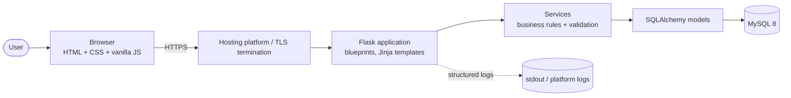
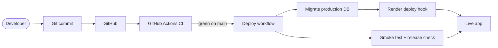

# Architecture

HemoLink is a **modular monolith**: one Flask application, one MySQL database, no
microservices or queues. It is organised in layers so each concern is easy to find,
test and explain.

## System diagram

Delivery is shown separately (it is not part of the request path):

## Layers

| Layer | Location | Responsibility |
|---|---|---|
| Presentation | `app/templates`, `app/static` | Jinja templates, one shared CSS design system, small vanilla JS enhancements |
| Routing | `app/<blueprint>/routes.py` | HTTP only: parse input, call a service, render or redirect, authorise by role |
| Business logic | `app/services/` | Validation, rules (duplicate requests, state transitions, consent), notifications, audit |
| Data access | `app/models/` | SQLAlchemy models, constraints, indexes |
| Persistence | MySQL 8 | Data, enforced by foreign keys and CHECK constraints |
| DevOps | `Dockerfile`, `docker-compose.yml`, `.github/` | Containers, CI, deployment |

Blueprints: `main` (public pages, health), `auth`, `dashboard` (dashboards and account),
`donors` (profile and search), `blood_requests`, `contact`, `notifications`, `admin`.
The app factory is `app.create_app(config_name, overrides)`.

## Key design decisions

* **Validation is pure Python** (`services/validation.py`): it takes a mapping and
  returns `(cleaned, errors)` with no database or HTTP dependency, so it is unit tested
  directly. Controlled vocabularies (blood groups, statuses, states) live in `app/constants.py`
  and also generate the database CHECK constraints.
* **Atomic state changes.** Accepting, declining, withdrawing and revoking a contact
  request use a single `UPDATE ... WHERE status = 'pending'` and check the row count, so
  a request can never be accepted twice, even with concurrent clicks.
* **Authorisation is layered.** `role_required` on every view; the admin blueprint adds
  a `before_request` guard; services re-check ownership; foreign records return 404
  rather than 403 so IDs cannot be probed.
* **Suspension takes effect immediately.** `load_user` returns no user for suspended or
  deleted accounts, so existing sessions are cut off on the next request.
* **Consent model.** `contact_requests.donor_consent_at` records when a donor accepted;
  `recipient_access_revoked_at` records when they withdrew it. A recipient sees a phone
  number only when `status = accepted`, consent exists, access is not revoked and the donor
  account is active (`ContactRequest.recipient_can_view_contact`).
* **Account deletion anonymises.** Name, email and phone are replaced, the donor profile
  and notifications are deleted, open requests are cancelled, pending contact requests are
  closed. Blood requests and contact requests remain in anonymised form; audit entries keep
  numeric ids only.
* **Timestamps** are naive UTC (`app/utils/time.py`) and displayed as UTC.
* **Email** is behind `services/mailer.py`: SMTP when `MAIL_SERVER` is set; otherwise a
  development-only console backend that is refused in production. The forgot-password page
  says plainly when email delivery is unavailable instead of pretending to send.

## Security design

| Concern | Implementation |
|---|---|
| Passwords | Werkzeug `generate_password_hash` (scrypt); minimum policy; never logged |
| Sessions | HttpOnly, SameSite=Lax, Secure in production, 8-hour lifetime, Flask-Login "strong" protection |
| CSRF | Flask-WTF `CSRFProtect` on every POST (logout included) |
| Injection | ORM and bound parameters only; LIKE wildcards escaped; strict allow-lists |
| XSS | Jinja autoescape; no `safe` filter on user data; CSP `script-src 'self'; style-src 'self' https://fonts.googleapis.com` with no inline code |
| Headers | CSP, X-Frame-Options, nosniff, Referrer-Policy, Permissions-Policy, HSTS over HTTPS, `no-store` for signed-in pages |
| Rate limits | Login (per IP and per email), registration, password reset, contact requests, password change, account deletion |
| Reset tokens | 32 random bytes, only the SHA-256 hash is stored, 30-minute expiry, single use, older tokens invalidated |
| Open redirects | `next` parameters accepted only if they are same-site paths |
| Secrets | Environment variables only; production refuses to start without a strong `SECRET_KEY` |
| Errors | Generic 500 page, health endpoints reveal no internals, request ids for correlation |
| Enumeration | Login errors are generic; reset requests give the same response for unknown emails. (Registration does say an email is taken: an accepted trade-off, rate-limited.) |

The in-memory rate limiter is per worker. For several instances use a shared store.

## Logging and health

* Production logs are JSON lines on stdout: timestamp, level, logger, message and, for
  requests, request id, method, path (no query string), status, duration and user id.
* `/health/live` reports the process is up (and the release id if known).
  `/health/ready` runs `SELECT 1` and returns 503 with `{"status":"unavailable"}` on failure.
