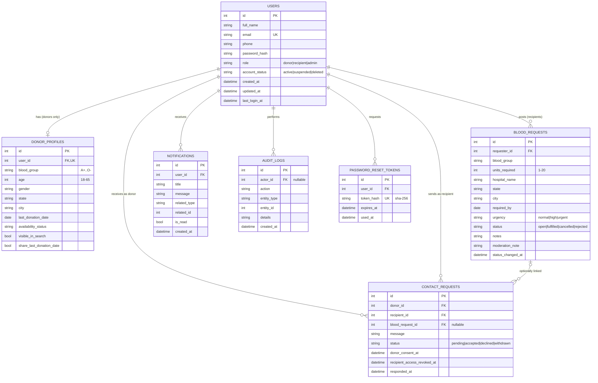

# Database

MySQL 8 (utf8mb4). Schema changes are managed with Alembic through Flask-Migrate; the
initial migration is `migrations/versions/7c1f2a9d4b10_initial_schema.py`.
Constraint names follow a fixed naming convention (`app/extensions.py`) so migrations
stay stable. Controlled vocabularies are enforced with CHECK constraints (enforced by
MySQL 8.0.16+).

## Entity relationship diagram

Core columns are shown below; `created_at` / `updated_at` audit timestamps are omitted from
some entities for readability but are present in the migration and models.



## Relationships and deletion behaviour

* `users` 1-to-0..1 `donor_profiles` (unique `user_id`, `ON DELETE CASCADE`).
* `users` 1-to-many `blood_requests`, `notifications`, `password_reset_tokens`
  (`ON DELETE CASCADE`).
* `contact_requests` link two users: `donor_id` and `recipient_id` (both cascade) and
  optionally a blood request (`ON DELETE SET NULL`).
* `audit_logs.actor_id` is `ON DELETE SET NULL` so the audit trail survives user removal.
* The application never hard-deletes users in normal operation: deletion anonymises
  (see architecture). Cascades matter only for the demo-data reset command.

## Indexes and constraints

| Table | Notable indexes / constraints | Why |
|---|---|---|
| users | unique `email`; `(role, account_status)`; `created_at`; CHECKs on role and status | login lookup, admin filters |
| donor_profiles | `(visible_in_search, blood_group, state, city)`; `availability_status`; CHECKs on blood group, availability, age | the donor search query |
| blood_requests | `(requester_id, status)`; `(status, blood_group, state, city)`; `created_at`; CHECKs on group, urgency, status, units | "my requests" and donor discovery |
| contact_requests | `(donor_id, recipient_id, blood_request_id)`; `(donor_id, status)`; `(recipient_id, status)`; CHECK on status | duplicate checks and inbox queries |
| notifications | `(user_id, is_read, created_at)` | unread counts and lists |
| audit_logs | `created_at`; `(actor_id, created_at)`; `(entity_type, entity_id)` | admin log browsing |
| password_reset_tokens | unique `token_hash`; `user_id` | token lookup |

The "no duplicate active contact request for the same purpose" rule depends on NULL
handling (`blood_request_id` is nullable), which a MySQL unique index cannot express, so
it is enforced in `services/contacts.py` and covered by tests.

## Search query

Search is a single SQL query (no client-side filtering): joins `donor_profiles` to
`users`, requires `visible_in_search`, an active account and the donor role, applies the
optional filters (case-insensitive prefix match for city, substring for name, with LIKE
wildcards escaped), orders by availability then name, and paginates in the database.
Sorting by last donation date is deliberately not offered because it would leak the date
of donors who chose not to share it.

## Migrations

```bash
flask --app run db upgrade      # apply
flask --app run db downgrade base
flask --app run db migrate -m "describe change"   # generate after changing models
flask --app run db check        # fails if models and migrations differ
```

The initial migration was written by hand and cross-checked against the models
programmatically (tables, columns, nullability, indexes, constraint names and foreign
keys matched). CI also runs `db upgrade`, `db check`, `db downgrade base` and
`db upgrade` against MySQL. If `db check` reports a difference on first run, regenerate
with `flask db migrate` and review the result.

## Backups

Take a backup before every production migration (see `deployment.md`). Locally:

```bash
docker compose exec db sh -c 'mysqldump -uroot -p"$MYSQL_ROOT_PASSWORD" "$MYSQL_DATABASE"' > backup.sql
```
