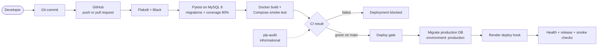

# DevOps pipeline

## Overview



## Git workflow

* `main`: always releasable and the only branch that deploys.
* `develop` (optional), `feature/*`, `fix/*`: short-lived branches merged by pull request.
* Every pull request into `main` runs CI. Mark the **CI result** job as a required status
  check in *Settings → Branches → Branch protection* so a red CI cannot be merged.
* Commit messages: `feat:`, `fix:`, `test:`, `ci:`, `docs:`, `chore:`.

## CI workflow (`.github/workflows/ci.yml`)

Triggers: push to `main` and `develop`, pull requests to `main`, manual dispatch.
Permissions: `contents: read` only. No secrets are referenced, so pull requests from
forks cannot exfiltrate anything. Runs for the same ref cancel each other
(`concurrency`).

| Job | What it does | Blocks deployment? |
|---|---|---|
| `lint` | `flake8 app tests scripts run.py`; `black --check --diff .` | Yes |
| `test` (needs lint) | Starts a MySQL 8 service container; `flask db upgrade`; `flask db check`; `flask db downgrade base` then `upgrade`; `pytest --cov=app --cov-fail-under=80` with `TEST_USE_MIGRATIONS=1` so the test schema is built **by the migrations**; uploads `coverage.xml` and `requirements-resolved.txt` | Yes |
| `security` | `pip-audit -r requirements.txt` | No (informational, `continue-on-error`) |
| `docker` (needs test) | Creates a throw-away `.env`, `docker compose build`, `docker compose up -d`, runs `scripts/smoke_test.sh http://localhost:8000`, prints logs on failure, `docker compose down -v` | Yes |
| `ci-success` | Writes a summary table and fails unless lint, test and docker all succeeded | Yes (it is the single status to require) |

Actions are pinned to major versions (`actions/checkout@v4`, `setup-python@v5`,
`upload-artifact@v4`). For stricter supply-chain control pin them to commit SHAs.
The MySQL credentials in `ci.yml` are throw-away values for a container that exists only
for the job. They protect nothing.

Dependency versions: `requirements.txt` uses compatible ranges. Each CI run records the
exact resolved versions in the `test-reports` artifact (`requirements-resolved.txt`),
which satisfies "record the versions used". To lock them, copy that file to a
`requirements.lock` and install from it in the Dockerfile.

## CD workflow (`.github/workflows/deploy.yml`)

Triggers: `workflow_run` of **CI** completing on `main`, or manual dispatch on `main`.

1. **gate**: proceeds only if CI concluded `success` for a *push* to `main` (or a manual
   run on `main`). Output: the commit SHA to deploy.
2. **migrate** (`environment: production`): installs dependencies at that SHA and runs
   `flask db current` then `flask db upgrade` against `PRODUCTION_DATABASE_URL`. Add
   *required reviewers* to the `production` environment to approve each migration by hand.
3. **deploy** (needs migrate): `curl --silent --fail -X POST $RENDER_DEPLOY_HOOK_URL`.
   `--silent` keeps the secret hook URL out of the logs.
4. **verify**: `scripts/smoke_test.sh $PRODUCTION_URL <sha>` waits up to 20 minutes for
   `/health/ready`, confirms `/health/live` reports the deployed release (Render exposes
   the commit as `RENDER_GIT_COMMIT`), then checks the landing, login, registration and
   static pages, that `/admin/`, `/donors/search`, `/dashboard` and `/requests/` redirect
   anonymous visitors, security headers, and HSTS over HTTPS.

Deployments are serialised (`concurrency: production-deploy`, never cancelled midway).
A failed migration stops the pipeline **before** the new code is requested.

Why migrations run in the workflow: Render's pre-deploy command requires a paid
instance type, and running `db upgrade` at every application start is risky (it races
with multiple instances and hides failures). A separate, auditable step is safer.
Schema changes must stay backwards compatible for the moment between "migrated" and
"new code live" (add columns before using them; remove them in a later release).

## Secrets and variables

| Name | Kind | Where | Purpose |
|---|---|---|---|
| `PRODUCTION_DATABASE_URL` | secret | `production` environment | Used by the migrate job |
| `RENDER_DEPLOY_HOOK_URL` | secret | `production` environment | Triggers the deploy |
| `PRODUCTION_URL` | variable | repository | Base URL for the smoke test, e.g. `https://hemolink.onrender.com` |
| `DB_SSL_CA` | variable | repository | CA bundle path if the database requires TLS |

Never put these in the repository. `.env` is git-ignored; `.env.example` holds placeholders.

## Local equivalents

```bash
black --check . && flake8 app tests scripts run.py     # lint job
pytest --cov=app --cov-fail-under=80                   # test job (SQLite by default)
docker compose run --rm test                           # test job against MySQL
docker compose up -d --build && sh scripts/smoke_test.sh http://localhost:8000   # docker job
```

## Proving the pipeline blocks bad changes

Create a branch, add a deliberate failure (an unused import, or `assert False` in a
test), push, and open a pull request: the corresponding job turns red, **CI result**
fails and the deploy workflow does not run. Revert and the pipeline turns green.
(This could not be demonstrated in the environment that generated the repository.)
